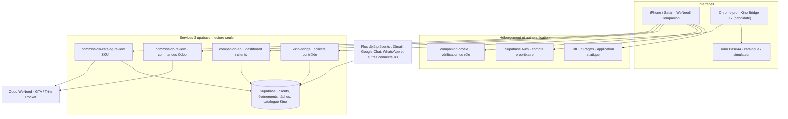

# WeNeed Companion — Cartographie et validation

> État de développement au 10 octobre 2026. Ce document décrit **la branche candidate**, non la version effectivement installée sur iPhone ou Chrome.

## Carte des flux



## Statut par module

| Module | Code de la candidate | Test automatisé | Test réel restant |
|---|---|---|---|
| Auth propriétaire | Implémenté, gestion des rafraîchissements simultanés | Oui, logique de concurrence | Connexion et déconnexion réelles sur Safari / Chrome |
| Commandes Odoo GTA/TR | Vue mensuelle, recherche, statuts et détail | Oui, validateur des rapports | Requête Odoo authentifiée sur plusieurs mois |
| Kino Bridge 0.7 | Recherche sûre et capture des SKU | Oui, DOM simulé | Chrome professionnel et simulateur réel |
| Rapprochement Kino | Catalogue 1 385 SKU, société + SKU | Oui, contrôles de cohérence | Résoudre l'erreur serveur 502 et vérifier les écarts réels |
| CRM clients | Recherche et fiches privées en lecture seule | Oui, normalisation API + contrat HTML | Navigation / requêtes réelles sur iPhone |
| Accueil CRM | Statistiques et clients à suivre, indépendants d'Odoo | Oui, structure des réponses | Test avec le JWT du propriétaire |
| Montant des commissions | **Non calculé** : règles Kino / SPIFF non vérifiées | Affichage bloqué si montant inattendu | Validation des règles métier, frais et avoirs |
| Connecteurs externes | Plusieurs services côté Supabase déjà déployés | Hors périmètre de la présente PR | Contrôle de fraîcheur / couverture des synchronisations |

Les tests Node et GitHub Actions valident uniquement les composants testés. Ils ne prouvent pas le fonctionnement de l'extension dans un navigateur réel, ni la disponibilité d'Odoo.

## Points de vigilance

1. **Production** : GitHub Pages sert la branche `main`. Tant que cette PR est ouverte et non fusionnée, les nouvelles rubriques CRM et le Bridge 0.7 ne sont pas déployés sur l'interface utilisée.
2. **Dépendance Odoo** : plusieurs requêtes de rapprochement de septembre ont répondu HTTP 502 ; le rapport Odoo historique avait répondu 200. Ne pas en déduire que la panne Odoo est résolue.
3. **Rémunération** : aucun total issu d'Odoo ne doit être présenté comme commission acquise. Échantillons, produits gratuits, devis, retours, remises et règles Kino nécessitent une validation explicite.
4. **Sécurité** : ne jamais intégrer jeton JWT, mot de passe, clé Odoo, cookie ou données commerciales dans GitHub public ; utiliser les fonctions serveur.
5. **Session** : `sessionStorage` est volontairement éphémère. Déconnecter l'application sur un poste partagé.
6. **Kino 0.7** : candidat dérivé de l'extension 0.5 installée ; l'archive 0.6 a été récupérée et comparée ; ses variantes de suggestions et diagnostics locaux sont réintégrés (voir `KINO_BRIDGE_VALIDATION.md`). Conserver la 0.5 comme secours.

## Validation manuelle avant fusion

- [ ] Vérifier Safari iPhone : connexion propriétaire, retour depuis une app en arrière-plan, déconnexion, rechargement après expiration.
- [ ] Ouvrir « Clients », rechercher deux boutiques connues, lire contacts, tâches et historique sans aucune écriture.
- [ ] Accueil : confirmer que le bloc CRM peut s'afficher indépendamment de la lecture Odoo.
- [ ] Charger septembre 2026 dans « Commandes » et vérifier le total, la présence de GTA/TR et les statuts.
- [ ] Identifier l'origine exacte de l'erreur 502 de `commission-catalog-review` avant de la déclarer réparée.
- [ ] Vérifier des SKU présents dans les deux sociétés et les coûts/prix à zéro.
- [ ] Charger le Bridge 0.7 en parallèle **désactivé**, ne garder qu'une extension active durant chaque test, vérifier les fonctions de lecture.
- [ ] Sur GitHub, vérifier les tests Actions verts ; **fusionner seulement après les tests fonctionnels**.

## Commandes locales pour la candidate

```bash
npm test
npm run check:bridge
npm run check:app
```

## Validation Chromium et diagnostic Odoo (10 octobre 2026)

- Un workflow GitHub Actions exécute un **vrai navigateur Chromium en format mobile** avec des données **entièrement simulées** : propriétaire Supabase, accueil CRM, clients, commandes, commissions, déconnexion et diagnostic Odoo. Aucune requête commerciale réelle n'est utilisée.
- Cette validation prouve la navigation intégrée et les interactions dans le navigateur **contre les réponses de test**, pas l'authentification du compte réel ni l'accès Odoo réel.
- L'écran « Paramètres » possède désormais un diagnostic `odoo-read` qui appelle successivement `resource=ping` (authentification) et `resource=orders_probe` (droit de lecture). Le second ne retourne **aucun contenu de commande**.
- Le contrôle du rôle **owner** de `companion-api` et une journalisation d'erreurs non sensibles pour `commission-catalog-review` sont préparés sous `supabase/functions/` et **déployés le 10 octobre** après vérification : `companion-api` v11 (contrôle propriétaire) et `commission-catalog-review` v2 (journalisation du code d'erreur uniquement). Le reste de la logique métier reste inchangé.
- Tests serveur et navigateur lancés automatiquement dans GitHub Actions. Pour diagnostiquer une erreur 502 réelle, attendre le résultat du diagnostic Odoo effectué après connexion propriétaire ; ne pas inférer la cause à partir du seul statut HTTP.

**Conditions avant fusion/déploiement :** valider la connexion Safari authentifiée, les réponses réelles du CRM, le résultat du diagnostic Odoo, le rapprochement Kino et le fonctionnement de Kino Bridge en Chrome professionnel.

## Préversion hébergée et tests du site réel

**URL :** https://bradrien.github.io/weneed-companion-u/validation-v12/

- Les fichiers statiques de la candidate sont copiés séparément dans `validation-v12/` sur la branche `main`. Le site racine n'a pas été remplacé.
- La préversion utilise la même origine HTTPS que le site principal, sans CDN externe et sans intégration d'identifiants dans le code publié.
- Le workflow Chromium vérifie la préversion réellement hébergée, les fichiers statiques, l'écran de connexion non authentifié et le refus d'accès aux API protégées sans session. La vérification connectée nécessite encore une session propriétaire.
- Le navigateur de validation automatisé n'utilise que des données synthétiques et ne produit aucune écriture métier.
- Les deux changements Edge Functions limités sont déployés : contrôle explicite de l'accès propriétaire et journalisation d'un code d'erreur en cas d'échec du rapprochement.
- **À faire :** ouvrir la préversion dans un profil navigateur authentifié, tester les clients et exécuter « Vérifier l'accès Odoo » ; utiliser ensuite les journaux sécurisés pour le 502.

### Incident CORS Odoo sur iPhone (10 octobre 2026)

- L'écran D2 montrait `ping · network_error`. Les journaux `odoo-read` v9 ont confirmé des requêtes `OPTIONS` rejetées avec **403**, avant toute authentification Odoo.
- Correction chirurgicale déployée dans **`odoo-read` v10** : autorisation de l'origine exacte `https://bradrien.github.io` pour la préversion et le site principal, sans `*` dans le code métier, et en conservant les vérifications JWT propriétaire et le mode lecture seule. Aucun secret Odoo n'a été modifié.
- Régressions Node : origine autorisée, origine malveillante bloquée, absence de JWT, ping fictif valide et ancienne origine locale.
- Test HTTP sur la vraie fonction : prévol CORS désormais **204** au lieu de 403 ; la plateforme Supabase peut générer un en-tête CORS générique pour la requête `OPTIONS`, distinct de celui de la fonction métier.
- Un nouveau test depuis **Safari iPhone authentifié** reste nécessaire pour déterminer si les identifiants Odoo ou `ODOO_UID_PIN` sont refusés. Ce second problème est indépendant du CORS et n'est pas résolu par ce déploiement.

## Audit Odoo/Kino D4 — septembre 2026

Lors du premier rapprochement en lecture seule, l'application a montré **74 commandes** (24 GTA confirmées, 28 TR confirmées, 22 hors calcul), **71 lignes rapprochées sur 77 éligibles** et **6 lignes dont le produit Odoo ne fournit aucun SKU**. Aucune référence avec SKU n'est indiquée comme absente de Kino. Ces six lignes peuvent appartenir à moins de six produits distincts.

Le rapport indique aussi **460 lignes détectées par mots-clés « sample » / « échantillon »** et **50 lignes de livraison**, comptées sur **tous les statuts** (confirmées, brouillons, annulées). Ces chiffres ne prouvent pas l'exclusion contractuelle de ces lignes des commissions. Le code serveur classe d'abord les libellés « sample » / « livraison » avant de consulter les montants ; une ligne facturée peut donc être classée « sample ». **Un audit de cette classification est obligatoire avant calcul.**

Le nouveau module `assets/reconciliation.mjs` propose des détails directement sur la page *Commissions* :
- commandes, noms de produits et montants des lignes éligibles sans SKU ;
- sous-ensemble d'échantillons dans les commandes confirmées et d'échantillons avec HT positif, avec exemples ;
- lignes de livraison confirmées et facturées, à confronter aux règles Kino ;
- commandes confirmées à 0 €.

Aucune modification d'Odoo ni calcul de commission dans ces fonctions de présentation. Tests Node purs et validation navigateur Chromium ajoutés. Une préversion isolée est publiée sous `validation-v12/?build=D4`, avec fichiers JS/CSS versionnés.

**À valider ensuite :** relire les six lignes concrètes et confirmer que les produits sans SKU sont réellement vendus et non des erreurs de ligne ; distinguer la politique d'échantillons de la détection par mot-clé ; obtenir la méthode de calcul officielle GTA/TR, avec frais, avoirs et plafonds, avant toute estimation de rémunération.

## Audit D5 : regroupement des codes candidats et accès direct aux commandes

La lecture réelle de septembre 2026 indique six lignes sans SKU réparties sur **quatre codes candidats distincts en tête de description Odoo**, pour un montant source de 3 000 € HT. Ces chiffres ne sont pas des commissions. Le regroupement reste séparé par société (GTA/TR) et devise.

- Les codes entre crochets sont des **indices de saisie**, pas des SKU Kino vérifiés. Aucun rapprochement supplémentaire n'est effectué automatiquement.
- La page *Commissions → Audit Odoo* affiche les groupes, les montants source lorsque la devise est connue, et un bouton **Ouvrir la commande** sur chaque anomalie.
- Le bouton applique un filtre local à la référence Odoo et ouvre la commande développée dans l'onglet *Commandes*, sans requête d'écriture.
- L'extraction ne considère que les préfixes sous la forme `[CODE]` au début de la description ; aucune invention de SKU ni injection HTML.
- Tests unitaires : six lignes réparties en quatre groupes, 3 000 € HT ; test Chromium : navigation depuis l'audit vers la commande développée.
- Préversion sur GitHub Pages : `validation-v12/?build=D5`, scripts et styles versionnés pour contourner le cache iOS.

Les informations détaillées des clients et les descriptions commerciales restent dans le rapport privé de la session navigateur ; elles ne sont pas copiées dans le dépôt public.

## D6 — vérification de codes candidats dans le vrai catalogue Kino

- Vérification SQL, snapshot Kino complet daté du 10 octobre : les quatre codes candidats `GTA:TT/G`, `TR:PEB/G/TR/250`, `TR:TT/+/G/TR/250` et `TR:TT/+/G/TR/50` existent exactement dans le catalogue de leur société.
- Les six lignes Odoo restent **officiellement sans SKU**, pour **3 000 € HT de ventes Odoo concernées** ; la correspondance dans la description produit ne remplace pas la référence interne Odoo et ne prouve pas la commission due.
- `commission-catalog-review` **v5**, déployée, retourne pour chaque ligne sans SKU une **suggestion exacte de catalogue** uniquement si la description commence par `[SKU]`. La recherche vérifie la société et les doublons, et ne change pas `catalog_matching` ni `commission_eur:null`.
- L'audit mobile affiche la suggestion « référence exacte trouvée dans Kino », ou l'incertitude si elle n'est pas retrouvée. Aucun SKU et aucun montant de commission ne sont modifiés côté Odoo.
- Préversion isolée D6 : `https://bradrien.github.io/weneed-companion-u/validation-v12/?build=D6`. Navigation vers les commandes conservée.
- Les règles de calcul Kino GTA/TR, la politique d'échantillons et les éventuels avoirs restent **à valider** avant tout montant de commission.


## D9 — Fiche client 360° enrichie, première étape CRM

La capture iPhone de la fiche Green Purple montre que la recherche CRM, les contacts, la mémoire et les derniers événements Gmail/Google Chat fonctionnent, mais que la vue initiale ne présente ni dossier commercial complet ni commandes Odoo.

**Données effectivement présentes :** l'API propriétaire `companion-api` possède déjà `GET /clients/{uuid}`, basé sur `api_get_client_360`, avec `business_objects` (factures, avoirs et autres références CRM), `conversations`, `key_facts`, `stale_tasks`, en plus de `GET /clients/{uuid}/card`. Pour Green Purple, cette API contient plusieurs conversations, faits et références financières (pas de preuve de paiement bancaire). D9 utilise ces deux endpoints **sans aucun nouveau déploiement backend ni écriture SQL**.

- `assets/client-360-model.mjs` normalise les données enrichies, impose le même UUID client et borne tous les champs et listes.
- `assets/app.js` charge la fiche courte et la vue complète simultanément. La fiche courte reste accessible même si l'extension 360 échoue ; une alerte différencie les deux.
- La rubrique **Dossier commercial** présente les sources de conversations, les documents et références identifiés, les faits issus des échanges et les anciennes pistes nécessitant une vérification. Aucun statut de facture `paid` vu dans un e-mail n'est présenté comme encaissement comptable confirmé.
- La rubrique **Commandes Odoo · période analysée** exploite uniquement le rapport Odoo déjà chargé dans la session propriétaire pour rechercher un **nom strictement identique**, normalisé en casse et espaces. La proposition est **non validée**, pas une association permanente `partner_id → client_id`. Pas de fusion de clients, pas de recherche floue ou sur les boutiques filles. Un bouton ouvre la commande originale pour examen.
- Cette rubrique **n'est pas un historique global de commandes** : elle couvre exclusivement le mois actuellement chargé. Son absence de résultat ne prouve pas qu'un client n'a jamais commandé.
- Tests purs de normalisation / nom exact et smoke Chromium mobile avec réponses Supabase entièrement fictives.
- Préversion privée : `https://bradrien.github.io/weneed-companion-u/validation-v12/?build=D9`.

**Suite nécessaire :** vérifier la relation d'identité CRM ↔ `res.partner.id` d'Odoo (et les entreprises filles) avant un historique multi-mois véritablement fiable ; relier le CRM aux commandes historiques et, ensuite, organiser les échanges en jalons commerciaux avec sources et validations.

## D10 — audit de l'identité Odoo sur la fiche CRM

La capture propriétaire D9 de Green Purple a validé la présence de trois commandes exactes sur septembre : S03515 (10 546 €), T01981 (0 €), S03591 (7 500 €, statut `cancel`). Les faits et références comptables issus de Gmail restent des **déclarations issues de messages** et non des encaissements attestés.

- `commission-catalog-review` v7 expose seulement l'entier Odoo `res.partner.id` dans `orders[].partner_odoo_id`, en plus du nom déjà présent. Le filtre, l'autorisation JWT et la lecture seule restent inchangés.
- `client-360-model.mjs` recopie cet entier uniquement s'il est valide et signale si plusieurs IDs distincts partagent le même nom, ou si une commande n'a pas d'ID utilisable. Il ne crée **aucune relation persistante**.
- La fiche D10 montre cet ID et un avertissement sur les identités potentiellement distinctes. Le bouton dit « Voir la commande dans Companion » car il ouvre l'onglet local, pas directement Odoo.
- La synthèse CRM existante est clairement identifiée comme « automatique non vérifiée, langue d'origine » et rappelle que les mentions « paid » ne prouvent pas un paiement.
- Tests unitaires de conflits entre IDs, de non-fusion et d'absence d'ID ; préversion isolée `https://bradrien.github.io/weneed-companion-u/validation-v12/?build=D10`.

**Prochaine étape** : vérifier manuellement que les identifiants Odoo de Green Purple désignent bien cette société (puis ses éventuelles boutiques), enregistrer un lien autorisé seulement après confirmation, et interroger les historiques sans limitations au mois courant. Les factures/avoirs doivent être recoupés séparément.

## D11 — Historique client Odoo sur trois ans, lecture seule

Après les captures Green Purple D10, les commandes S03515, T01981 et S03591 utilisent toutes `res.partner.id = 3277`. Cela prouve un identifiant partenaire unique **pour ces trois commandes**, mais pas à lui seul la correspondance légale entre `clients.id` (UUID CRM) et le partenaire Odoo.

L'examen Supabase montre que la fiche CRM Green Purple possède une identité e-mail liée à Gmail et une identité téléphone issue d'un import Odoo, mais **aucun mapping vérifié `client_id ↔ res.partner.id`**. Aucun lien automatique n'a été inséré.

- `supabase/functions/client-odoo-history/index.ts` : nouvelle fonction GET, exige JWT Supabase confirmé + `app_access_users.role='owner'` actif et autorisation d'origine. Recherche **en lecture seule** de `sale.order` sur trois années glissantes, avec domaine exact `partner_id = N`, `user_id = UID`, période bornée et plafonnement à 250 commandes.
- N'autorise aucune écriture Odoo, ne renvoie aucune clé API. En cas de basculement du statut d'une commande pendant la lecture, l'historique est refusé plutôt que présenté comme cohérent. Les commandes GTA/TR sont séparées, les annulations restent visibles.
- `assets/client-history-model.mjs` vérifie strictement le `partner_id` de chaque ligne, son caractère non validé, les doublons et les devises ; chiffre d'affaires HT des seules commandes confirmées si EUR cohérent. Aucun calcul des commissions ni preuve de paiement.
- Dans D11, l'utilisateur peut demander explicitement « Consulter les commandes sur 3 ans » **uniquement si toutes les commandes du mois au nom exact correspondent à un unique partenaire Odoo valide**. Aucun rapprochement par numéro ou nom approximatif ; pas de fusion permanente. Regroupement visuel des années, statuts et montants.
- La fonction a été déployée avec vérification JWT activée. Tests unitaires, contractuels et smoke Chromium mobile avec données inventées ; la lecture **réelle du compte #3277 reste à tester par le propriétaire** sur le site hébergé.
- Préversion : `https://bradrien.github.io/weneed-companion-u/validation-v12/?build=D11`.

La suite sera de comparer les coordonnées de `res.partner(3277)` aux identités CRM/import Odoo puis de demander une confirmation de rattachement ; un futur historique multi-mois durable ne devrait plus dépendre de la présence d'une commande dans la période affichée.

## D12 — recoupement des coordonnées Odoo / CRM sans création de lien

La capture réelle de D11 pour le partenaire Odoo `#3277` confirme : 28 commandes trouvées depuis 2026, dont 13 au statut confirmé et 15 au statut annulé ; chiffres d'affaires HT des seules commandes confirmées GTA 71 245,50 € et TR 46 100 €. Il n'y a aucune ligne de 2023–2025 dans la réponse, ce qui ne prouve pas l'absence d'achats hors périmètre du commercial ou sous d'autres partenaires Odoo.

Le SQL CRM contient pour la fiche Green Purple (UUID déjà connu) une identité e-mail issue de Gmail et un numéro issu de l'import Odoo, mais aucune association vérifiée au partenaire Odoo `#3277`.

- `client-odoo-history` v2 ajoute une lecture **facultative, en lecture seule** de `res.partner` pour l'identifiant ayant au moins une commande accessible au commercial, sans exposer d'autres contacts. En cas d'absence d'autorisation de lecture, l'historique demeure disponible et l'identité Odoo est marquée inaccessible.
- Champs limités à nom, e-mail, téléphone, mobile, rue, code postal, ville, et identifiant éventuel du partenaire parent. Aucun justificatif de paiement ni écriture CRM.
- `assets/client-history-model.mjs` valide le partenaire renvoyé, puis compare localement le nom, l'e-mail et le téléphone (formats FR) avec les contacts et la fiche CRM. **Toutes les concordances sont des indices non validés et n'activent aucune fusion automatique**.
- La fiche D12 affiche le résultat du recoupement avec sa provenance Odoo et un avertissement « lien CRM ↔ Odoo NON VALIDÉ ». Si plusieurs ID partenaires portent le même nom, la fonctionnalité historique demeure verrouillée.
- Tests de l'absence de fusion, identité Odoo incompatible, comparaisons de contacts, accès propriétaire et parcours Chromium fictif.
- Préversion : `https://bradrien.github.io/weneed-companion-u/validation-v12/?build=D12`.

Une vérification humaine de la fiche partenaire `#3277` est encore nécessaire avant l'enregistrement d'un lien stable permettant de rechercher tout l'historique commercial sans dépendre du mois sélectionné.

## D13 — Diagnostic sûr lorsque les coordonnées Odoo sont inaccessibles

Une capture réelle de la fiche Green Purple D12 confirme que l'historique du partenaire `#3277` retourne toujours 28 commandes (13 confirmées, 15 annulées), mais qu'un avertissement générique « fiche partenaire Odoo inaccessible » apparaît.

Analyse du code : `getPartnerIdentity` utilisait un unique `res.partner.search_read` avec 9 champs et retournait `null` sur **toute** erreur ou réponse vide, supprimant la cause observable. On ne peut donc pas conclure sur les permissions du compte API à partir de D12.

- `client-odoo-history` v3 : lecture progressive **en lecture seule** des champs complets, puis nom/e-mail/téléphone, puis nom seulement ; chaque niveau échoué donne lieu à un essai plus restreint. Des diagnostics énumérés (`complete`, `partial`, `name_only`, `not_visible`, `odoo_partner_read_rejected`, `no_accessible_orders`) sont retournés séparément des commandes. Aucun détail d'erreur brut Odoo n'est exposé ni journalisé.
- La normalisation refuse les diagnostics inconnus, ne suppose pas qu'une correspondance nominale établit l'identité et garde le statut CRM ↔ Odoo **non vérifié**.
- La fiche D13 affiche si les coordonnées sont partielles, si le partenaire n'est pas visible, ou si la lecture est refusée jusque sur les champs minimaux.
- Déploiement effectué **sans changement de secrets, permissions ou écritures Odoo**. Tests Node, contrat serveur et smoke Chromium réussis.
- Préversion : `https://bradrien.github.io/weneed-companion-u/validation-v12/?build=D13`.

**À tester** : recharger D13 et la fiche Green Purple, cliquer « Consulter les commandes sur 3 ans », capturer uniquement le bandeau diagnostic situé avant la liste d'années. Si `odoo_partner_read_rejected`, investiguer les ACL sur `res.partner`. Si lecture partielle, valider la concordance des champs disponibles. Dans tous les cas, aucune association persistante sans validation explicite.

## D14 — liaison CRM Green Purple ↔ partenaire Odoo #3277 confirmée

Le propriétaire a confirmé explicitement dans la conversation, après validation D13 des concordances nom/e-mail/téléphone, que le client CRM Green Purple (`d4522538-54d8-497f-a80d-15a1cf214189`) correspond au partenaire Odoo `res.partner.id = 3277`.

- Migration Supabase `crm_manual_odoo_partner_links_with_revocation` : table `crm_odoo_partner_links` (clé CRM, identifiant Odoo, statut actif/révoqué, confirmation owner, horodatage, provenance minimale de la validation, date de révocation). Index uniques empêchant qu'un même partenaire Odoo soit lié à plusieurs CRM actifs. RLS activée : ni `anon` ni `authenticated` ne peuvent lire la table directement, seule la fonction de service propriétaire la consulte.
- Enregistrement créé et vérifié : **une association active #3277 → Green Purple**, aucune association concurrente. Révocation possible en passant le statut à `revoked` et en renseignant `revoked_at` (opération d'administration explicite, pas une suppression définitive).
- `companion-api` v14 : dans `GET /clients/{uuid}/card`, joint seulement la liaison active pour cette fiche **après vérification du compte propriétaire et de son JWT** ; si plusieurs liens actifs sont présents, l'API refuse de sélectionner un partenaire arbitraire.
- `assets/clients-model.mjs` refuse tout lien mal formé/non confirmé. D14 utilise le `partner_odoo_id` sauvegardé pour proposer l'historique de trois ans **indépendamment de la période affichée ou de la disponibilité du rapport Odoo mensuel**. Les propositions sur le mois courant restent distinguées des liaisons validées.
- Aucun changement dans les commandes, produits, données des contacts Odoo, commissions ou historiques source. Aucune fusion d'entreprises et aucune validation des paiements.
- Test navigateur Chromium avec liaison approuvée présente avant le chargement du rapport Odoo, test du modèle, tests du Bridge Kino, test du site hébergé.
- Préversion privée D14 : `https://bradrien.github.io/weneed-companion-u/validation-v12/?build=D14`.

À venir : test sur iPhone avec authentification réelle pour confirmer l'affichage automatique du lien, puis généralisation des appariements **uniquement** après validation de chaque entreprise.

## D15 — recherche de partenaires pour les autres clients et mémoire commerciale sourcée

Données existantes au 10/10/2026 : **131 fiches clients CRM**, **26 mémoires commerciales** et **une liaison propriétaire CRM ↔ Odoo active et vérifiée**, Green Purple ↔ `res.partner #3277`. La validation d'un client ne prouve pas la validation des autres ; les liaisons ne sont jamais propagées par nom.

Nouveau workflow `client-odoo-link` (fonction serveur JWT) :
1. GET `?client_id=<uuid>` recherche les commandes **du vendeur Odoo authentifié** dont le partenaire possède le **nom exactement identique** à la fiche CRM. Résultats partiels (120 commandes maximum), identifiants proposés seulement, aucun lien écrit.
2. L'utilisateur peut consulter l'historique trois ans du candidat via `client-odoo-history` et vérifier les coordonnées visibles.
3. Une double confirmation côté interface envoie `POST {action:"confirm",client_id,partner_id,confirmation:"CONFIRMER_LIAISON"}`. Le backend revérifie séparément le JWT propriétaire, le compte actif, l'identité CRM courante, l'authentification Odoo, une commande rattachée au vendeur, le **nom exact** et au moins une concordance réelle e-mail/téléphone. Refus si association concurrente ou preuve insuffisante ; jamais de lien automatique.
4. Deuxième confirmation possible pour `POST action:"revoke"` : désactive le lien via `status='revoked'` et `revoked_at`, sans supprimer l'audit ni modifier Odoo.
5. Les anciens liens Green Purple restent inchangés, et les clients ne sont jamais fusionnés par le seul nom.

Mémoire commerciale `assets/client-memory-model.mjs` : synthèse **déterministe, recalculée en lecture seule à partir des sources disponibles**, distinguant (a) commandes `sale/done/cancel` uniquement lorsque le lien Odoo propriétaire est confirmé, (b) activité CRM récente, (c) tâches en cours, (d) objets commerciaux documentaires non vérifiés par la comptabilité, (e) faits et anciennes pistes issus de l'extraction CRM, toujours marqués « à confirmer ». Le total HT de commandes confirmées n'est **ni une commission ni une preuve d'encaissement**. Pas d'écriture dans les mémoires CRM d'origine à ce stade.

Limites : recherche Odoo par nom exact, partielle, pouvant manquer des noms commerciaux divergents ; association impossible sans commande accessible et nom + contact concordant. La confirmation explicite et la vérification humaine restent nécessaires pour chaque client. Dans D15, aucun nouveau client n'est automatiquement rattaché.

Préversion isolée prévue : `https://bradrien.github.io/weneed-companion-u/validation-v12/?build=D15`.
