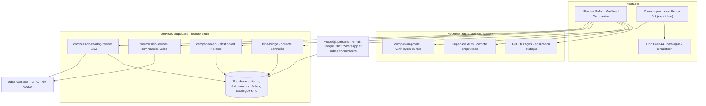

# WeNeed Companion — Cartographie et validation

> État de développement au 10 octobre 2026. Ce document décrit **la branche candidate**, non la version effectivement installée sur iPhone ou Chrome.

## Carte des flux



## Statut par module

| Module | Code de la candidate | Test automatisé | Test réel restant |
|---|---|---|---|
| Auth propriétaire | Implémenté, gestion des rafraîchissements simultanés | Oui, logique de concurrence | Connexion et déconnexion réelles sur Safari / Chrome |
| Commandes Odoo GTA/TR | Vue mensuelle, recherche, statuts et détail | Oui, validateur des rapports | Requête Odoo authentifiée sur plusieurs mois |
| Kino Bridge 0.7 | Recherche sûre et capture des SKU | Oui, DOM simulé | Chrome professionnel et simulateur réel |
| Rapprochement Kino | Catalogue 1 385 SKU, société + SKU | Oui, contrôles de cohérence | Résoudre l'erreur serveur 502 et vérifier les écarts réels |
| CRM clients | Recherche et fiches privées en lecture seule | Oui, normalisation API + contrat HTML | Navigation / requêtes réelles sur iPhone |
| Accueil CRM | Statistiques et clients à suivre, indépendants d'Odoo | Oui, structure des réponses | Test avec le JWT du propriétaire |
| Montant des commissions | **Non calculé** : règles Kino / SPIFF non vérifiées | Affichage bloqué si montant inattendu | Validation des règles métier, frais et avoirs |
| Connecteurs externes | Plusieurs services côté Supabase déjà déployés | Hors périmètre de la présente PR | Contrôle de fraîcheur / couverture des synchronisations |

Les tests Node et GitHub Actions valident uniquement les composants testés. Ils ne prouvent pas le fonctionnement de l'extension dans un navigateur réel, ni la disponibilité d'Odoo.

## Points de vigilance

1. **Production** : GitHub Pages sert la branche `main`. Tant que cette PR est ouverte et non fusionnée, les nouvelles rubriques CRM et le Bridge 0.7 ne sont pas déployés sur l'interface utilisée.
2. **Dépendance Odoo** : plusieurs requêtes de rapprochement de septembre ont répondu HTTP 502 ; le rapport Odoo historique avait répondu 200. Ne pas en déduire que la panne Odoo est résolue.
3. **Rémunération** : aucun total issu d'Odoo ne doit être présenté comme commission acquise. Échantillons, produits gratuits, devis, retours, remises et règles Kino nécessitent une validation explicite.
4. **Sécurité** : ne jamais intégrer jeton JWT, mot de passe, clé Odoo, cookie ou données commerciales dans GitHub public ; utiliser les fonctions serveur.
5. **Session** : `sessionStorage` est volontairement éphémère. Déconnecter l'application sur un poste partagé.
6. **Kino 0.7** : candidat dérivé de l'extension 0.5 installée ; l'archive 0.6 a été récupérée et comparée ; ses variantes de suggestions et diagnostics locaux sont réintégrés (voir `KINO_BRIDGE_VALIDATION.md`). Conserver la 0.5 comme secours.

## Validation manuelle avant fusion

- [ ] Vérifier Safari iPhone : connexion propriétaire, retour depuis une app en arrière-plan, déconnexion, rechargement après expiration.
- [ ] Ouvrir « Clients », rechercher deux boutiques connues, lire contacts, tâches et historique sans aucune écriture.
- [ ] Accueil : confirmer que le bloc CRM peut s'afficher indépendamment de la lecture Odoo.
- [ ] Charger septembre 2026 dans « Commandes » et vérifier le total, la présence de GTA/TR et les statuts.
- [ ] Identifier l'origine exacte de l'erreur 502 de `commission-catalog-review` avant de la déclarer réparée.
- [ ] Vérifier des SKU présents dans les deux sociétés et les coûts/prix à zéro.
- [ ] Charger le Bridge 0.7 en parallèle **désactivé**, ne garder qu'une extension active durant chaque test, vérifier les fonctions de lecture.
- [ ] Sur GitHub, vérifier les tests Actions verts ; **fusionner seulement après les tests fonctionnels**.

## Commandes locales pour la candidate

```bash
npm test
npm run check:bridge
npm run check:app
```

## Validation Chromium et diagnostic Odoo (10 octobre 2026)

- Un workflow GitHub Actions exécute un **vrai navigateur Chromium en format mobile** avec des données **entièrement simulées** : propriétaire Supabase, accueil CRM, clients, commandes, commissions, déconnexion et diagnostic Odoo. Aucune requête commerciale réelle n'est utilisée.
- Cette validation prouve la navigation intégrée et les interactions dans le navigateur **contre les réponses de test**, pas l'authentification du compte réel ni l'accès Odoo réel.
- L'écran « Paramètres » possède désormais un diagnostic `odoo-read` qui appelle successivement `resource=ping` (authentification) et `resource=orders_probe` (droit de lecture). Le second ne retourne **aucun contenu de commande**.
- Le contrôle du rôle **owner** de `companion-api` et une journalisation d'erreurs non sensibles pour `commission-catalog-review` sont préparés sous `supabase/functions/` et **déployés le 10 octobre** après vérification : `companion-api` v11 (contrôle propriétaire) et `commission-catalog-review` v2 (journalisation du code d'erreur uniquement). Le reste de la logique métier reste inchangé.
- Tests serveur et navigateur lancés automatiquement dans GitHub Actions. Pour diagnostiquer une erreur 502 réelle, attendre le résultat du diagnostic Odoo effectué après connexion propriétaire ; ne pas inférer la cause à partir du seul statut HTTP.

**Conditions avant fusion/déploiement :** valider la connexion Safari authentifiée, les réponses réelles du CRM, le résultat du diagnostic Odoo, le rapprochement Kino et le fonctionnement de Kino Bridge en Chrome professionnel.

## Préversion hébergée et tests du site réel

**URL :** https://bradrien.github.io/weneed-companion-u/validation-v12/

- Les fichiers statiques de la candidate sont copiés séparément dans `validation-v12/` sur la branche `main`. Le site racine n'a pas été remplacé.
- La préversion utilise la même origine HTTPS que le site principal, sans CDN externe et sans intégration d'identifiants dans le code publié.
- Le workflow Chromium vérifie la préversion réellement hébergée, les fichiers statiques, l'écran de connexion non authentifié et le refus d'accès aux API protégées sans session. La vérification connectée nécessite encore une session propriétaire.
- Le navigateur de validation automatisé n'utilise que des données synthétiques et ne produit aucune écriture métier.
- Les deux changements Edge Functions limités sont déployés : contrôle explicite de l'accès propriétaire et journalisation d'un code d'erreur en cas d'échec du rapprochement.
- **À faire :** ouvrir la préversion dans un profil navigateur authentifié, tester les clients et exécuter « Vérifier l'accès Odoo » ; utiliser ensuite les journaux sécurisés pour le 502.

### Incident CORS Odoo sur iPhone (10 octobre 2026)

- L'écran D2 montrait `ping · network_error`. Les journaux `odoo-read` v9 ont confirmé des requêtes `OPTIONS` rejetées avec **403**, avant toute authentification Odoo.
- Correction chirurgicale déployée dans **`odoo-read` v10** : autorisation de l'origine exacte `https://bradrien.github.io` pour la préversion et le site principal, sans `*` dans le code métier, et en conservant les vérifications JWT propriétaire et le mode lecture seule. Aucun secret Odoo n'a été modifié.
- Régressions Node : origine autorisée, origine malveillante bloquée, absence de JWT, ping fictif valide et ancienne origine locale.
- Test HTTP sur la vraie fonction : prévol CORS désormais **204** au lieu de 403 ; la plateforme Supabase peut générer un en-tête CORS générique pour la requête `OPTIONS`, distinct de celui de la fonction métier.
- Un nouveau test depuis **Safari iPhone authentifié** reste nécessaire pour déterminer si les identifiants Odoo ou `ODOO_UID_PIN` sont refusés. Ce second problème est indépendant du CORS et n'est pas résolu par ce déploiement.
